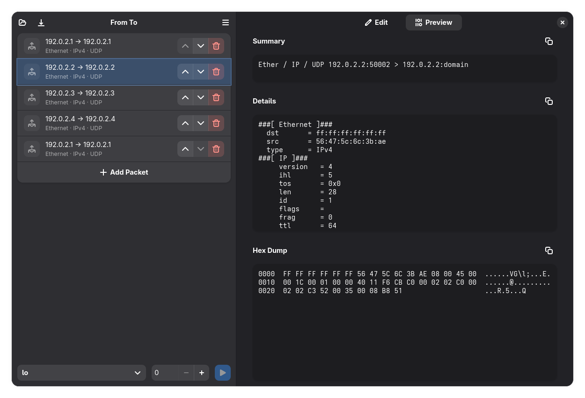

# From To

[](COPYING)
[](https://www.gnome.org/)
[](https://stopthemingmy.app)


From To is a network packet crafting tool for creating, editing, and sending custom packets.

It lets you configure Ethernet, IPv4, TCP, UDP, and ICMP headers, inspect packets in hexadecimal form, and send them through a selected network interface.

Built with GTK and libadwaita, From To follows GNOME design philosophy and integrates naturally with the GNOME desktop.


## Screenshots




## Building

From To uses [Meson](https://mesonbuild.com/) as its build system and [Ninja](https://ninja-build.org/) as its build backend.

Before building, make sure the required build tools and application dependencies are installed. For example, on Fedora, you can install them with:

```
sudo dnf install python3 meson ninja-build gtk4 glib2-devel python3-gobject python3-scapy
```

Package names and installation commands may differ on other distributions.

1. Clone the repository and navigate to the project directory:

   ```
   git clone https://github.com/eluvesi/fromto.git
   cd fromto
   ```

2. Configure and build the application:

   ```
   meson setup build
   meson compile -C build
   ```

3. Install the application:

   ```
   sudo meson install -C build
   ```

   To uninstall the application, run:

   ```
   sudo ninja uninstall -C build
   ```

